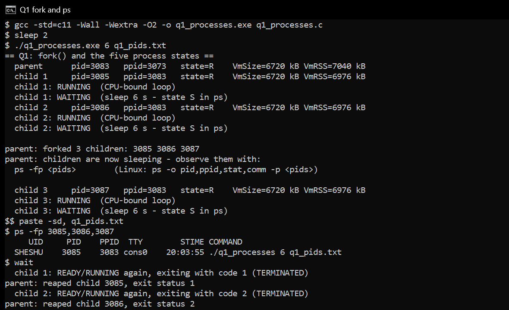
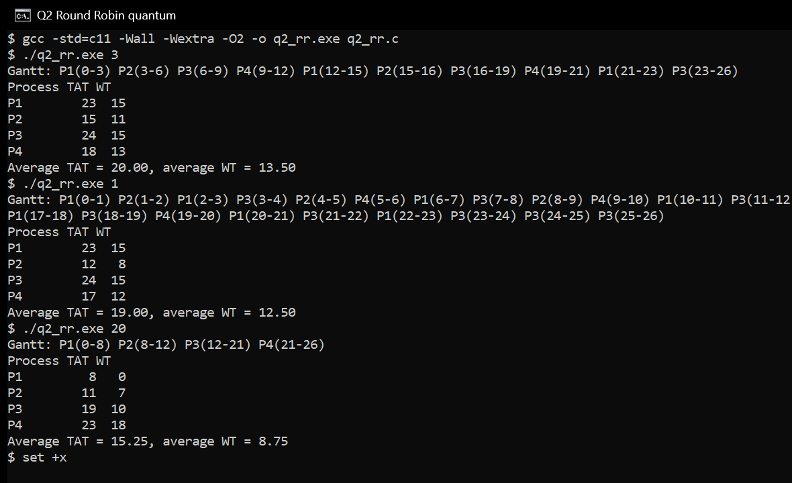
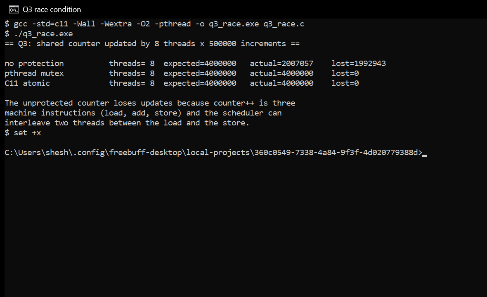
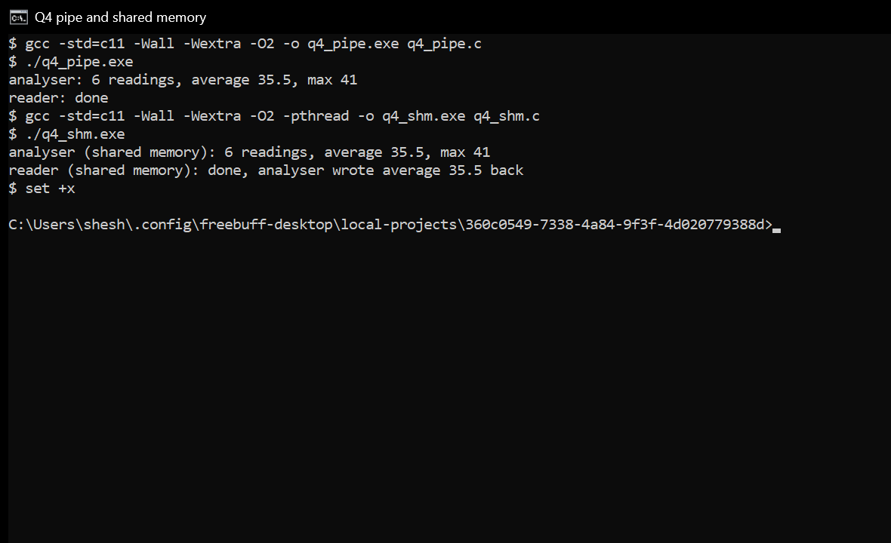
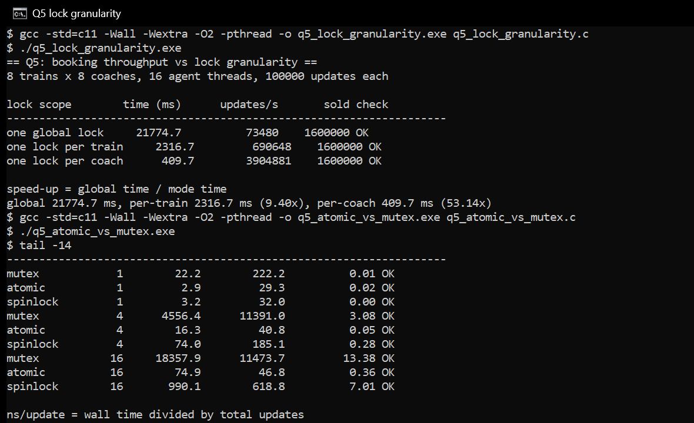
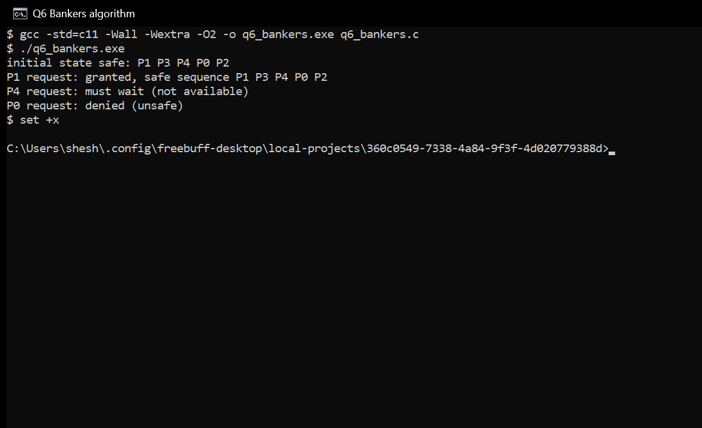

# CSA0406 Operating Systems - Assignment 2 (CO2)

**Evaluate and Justify Process-Management and Deadlock-Handling Designs**

| | |
|---|---|
| Student name | Sheshuraaj D |
| Register number | 1965260024 |
| Programme / year / section | CSE - Cybersecurity, 1st Year |
| Faculty | Dr. JAYASAKTHI VELMURUGAN K |
| Repository | https://github.com/sheshu2909/CSA0406-1965260024-Assignment2 |

> The repository follows the paper's naming convention, `CSA0406-<RegisterNumber>-Assignment2`.
> The earlier URL `https://github.com/sheshu2909/OS-ASSIGNMENT-2` redirects to it.

---

## 1  What this repository contains

One folder per task, each with the source code that produced the reported numbers and the captured
output. The full report (evaluation sheet + Q1-Q6 + appendices) is `Assignment_2_Final_Report.docx`.

| Task | Topic | Programs |
|---|---|---|
| Q1 | Processes and process states | `q1_processes.c`, `q1_overhead.c` |
| Q2 | CPU scheduling | `q2_rr.c`, `q2_scheduler.c`, `q2_quantum.c`, `q2_mixed.c` |
| Q3 | Threads | `q3_camera.c`, `q3_race.c` |
| Q4 | Inter-process communication | `q4_pipe.c`, `q4_pipe_noclose.c`, `q4_shm.c`, `q4_bench.c` |
| Q5 | Synchronisation, semaphores, monitors | `q5_bounded_buffer.c`, `q5_buffer_test.c`, `q5_peterson.c`, `q5_rw.c`, `q5_dining.c`, `q5_monitor.c`, `q5_lock_granularity.c`, `q5_atomic_vs_mutex.c` |
| Q6 | Deadlocks and Banker's algorithm | `q6_bankers.c`, `q6_bankers_trace.c`, `q6_bankers_scale.c` |

## 2  Build and run

Every program is C11 against the POSIX interface (`fork`, `pipe`, `mmap`, POSIX semaphores,
`pthread`, C11 atomics). No third-party libraries are used.

```bash
# from the folder of the task you are running
gcc -std=c11 -Wall -Wextra -O2 -pthread -o q3_camera q3_camera.c
./q3_camera 40 150000
```

All programs also build without `-pthread` where no threads are used (Q1 `q1_processes`, Q2, Q4
`q4_pipe`, Q6). The exact command for each program is in the report, Appendix B, and in each task folder's
`Screenshots/README.md` next to the captured output.

## 3  Verified results

These are the results obtained by running the programs. Each one is reproduced from the captured
transcript in the matching `Output/` folder.

**Q1 - creation cost** (200 iterations, Intel i7-10610U, 8 logical CPUs, MSYS2 POSIX layer):

| Operation | Measured |
|---|---|
| `fork()` + `waitpid()` | 39,890.1 us |
| `pthread_create()` + `pthread_join()` | 660.1 us |
| pipe round trip | 39.5 us |
| resident memory added by a process | ~7,040 kB |
| resident memory per thread | ~27.5 kB |

**Q2 - scheduling** (P1..P4, arrival 0/1/2/3, burst 8/4/9/5, priority 3/1/4/2):

| Policy | Avg turnaround | Avg waiting |
|---|---|---|
| FCFS | 15.25 | 8.75 |
| SJF | 14.25 | 7.75 |
| SRTF | 13.00 | 6.50 |
| Priority | 14.25 | 7.75 |
| Round Robin, q = 3 | 20.00 | 13.50 |

The Round Robin program prints exactly these averages, which is the required output.

**Q3 - threads** (64 cameras x 40 frames):

| Mode | Threads | Time (ms) | Speed-up |
|---|---|---|---|
| sequential | 1 | 1051.1 | 1.00x |
| thread per camera | 64 | 378.9 | 2.77x |
| pool | 4 | 287.5 | 3.66x |
| pool | 8 | 217.1 | 4.84x |
| pool | 16 | 214.0 | 4.91x |

Unprotected shared counter: 1,600,588 of 4,000,000 updates lost; the mutex and the atomic versions
both reach the exact total.

**Q4 - IPC** (best of three runs):

| Payload | Pipe (ms) | Shared memory (ms) |
|---|---|---|
| 1 MB | 1.50 | 1.07 |
| 10 MB | 6.66 | 17.21 |
| 100 MB | 108.45 | 159.66 |

**Q5 - synchronisation**:

| Measurement | Result |
|---|---|
| Bounded buffer (required program) | 20 items consumed, sum 210 - correct |
| 4 producers / 4 consumers, 100 runs | 100/100 correct, sum 2,001,000 |
| Same test without the mutex | 12/20 correct, 271 duplicates, 271 lost |
| Peterson, plain volatile | 2 mutual-exclusion violations in 2,000,000 |
| Peterson, C11 atomics | 0 violations |
| Peterson, flag-only lock | deadlock (timeout, exit 124) |
| Readers-writers | 0 violations, max 8 concurrent readers |
| Dining philosophers | 5,000 meals, max 2 eating, no deadlock |
| One global lock vs per-coach lock | 24,801 ms vs 393 ms (63x) |
| Atomic vs mutex, 16 threads | 27.1 ns vs 16,219 ns per update |

**Q6 - Banker's algorithm**: initial state safe with sequence P1 P3 P4 P0 P2; P1's request granted;
P4's request must wait; P0's request for (0,2,0) denied because the resulting state has no safe
sequence (Work = (2,1,0) and no process can finish). One safety check measured at 0.26 / 30.54 /
2,773 / 74,423 us for n = 10 / 100 / 1,000 / 5,000, consistent with O(m x n^2).

## 4  Screenshots from the actual runs

Each task folder has a `Screenshots/` folder with real console captures of that task's programs:
the compile line, the command line and the printed output of the run that was photographed.
The images were taken from the running console window with `PrintWindow`, so nothing is
retyped, re-rendered or edited.

| Task | Captures |
|---|---|
| Q1 | [fork, the five process states and `ps`](Q1_Processes_and_Process_States/Screenshots/q1_fork_and_ps.png), [process vs thread creation cost](Q1_Processes_and_Process_States/Screenshots/q1_overhead.png) |
| Q2 | [Round Robin with quantum 3, 1 and 20](Q2_CPU_Scheduling/Screenshots/q2_round_robin.png), [five scheduling policies](Q2_CPU_Scheduling/Screenshots/q2_policies.png) |
| Q3 | [thread pool speed-up](Q3_Threads/Screenshots/q3_threads.png), [lost updates without synchronisation](Q3_Threads/Screenshots/q3_race.png) |
| Q4 | [pipe against shared memory](Q4_IPC/Screenshots/q4_pipe_and_shm.png), [transfer benchmark](Q4_IPC/Screenshots/q4_bench.png) |
| Q5 | [bounded buffer, 100 correctness runs](Q5_Process_Synchronisation/Screenshots/q5_bounded_buffer.png), [lock granularity and atomic vs mutex](Q5_Process_Synchronisation/Screenshots/q5_locks.png) |
| Q6 | [Banker's algorithm: safe, granted, wait, denied](Q6_Deadlocks_and_Bankers_Algorithm/Screenshots/q6_bankers.png) |













## 5  Test cases

| Test | Purpose | File |
|---|---|---|
| `q1_processes 6` + `ps` | parent/child relationship, states, zombies avoided | Q1 |
| `q2_quantum` | quantum 1..20: response time against switch count | Q2 |
| `q2_mixed` | short-job vs long-job behaviour; starvation and ageing | Q2 |
| `q3_race` | lost update without synchronisation | Q3 |
| `q4_pipe_noclose` | end-of-file protocol; deadlock without `close()` | Q4 |
| `q5_buffer_test 4 4 100` | exactly-once delivery under contention | Q5 |
| `q5_buffer_test_nomutex` | index corruption when only semaphores are used | Q5 |
| `q5_peterson` x3 | reordering breaks Peterson; atomics fix it | Q5 |
| `q6_bankers_trace` | step-by-step Work vector for the unsafe request | Q6 |
| `q6_bankers_scale` | measured cost against the O(m x n^2) prediction | Q6 |

## 6  Platform and honesty notes

- All programs were compiled with `gcc -std=c11 -Wall -Wextra -O2 -pthread` and produced **no
  warnings**.
- The timings above were taken on Windows 11 with the MSYS2 POSIX layer. Absolute values are
  inflated by that layer; ratios and trends are what carry over. Re-run on the lab Linux machine
  before quoting absolute numbers in a viva.
- The captures in `Screenshots/` were taken while the programs above ran; no output has been
  invented or retyped. Wall-clock figures move slightly between runs, so a screenshot can show a
  different microsecond value from the benchmark table; the ratios and the correctness checks do
  not change. Each `Screenshots/README.md` says what its image shows.

## 7  Repository layout

```
.
|-- Q1_Processes_and_Process_States/   source, output, screenshots
|-- Q2_CPU_Scheduling/
|-- Q3_Threads/
|-- Q4_IPC/
|-- Q5_Process_Synchronisation/
|-- Q6_Deadlocks_and_Bankers_Algorithm/
|-- Diagrams/                          15 figures used in the report
`-- README.md
```

## 8  Commit history plan

One commit per task as it was completed: Q1, Q2, Q3, Q4, Q5, Q6, then documentation and the final
report. Commits made progressively show how the work developed; a single upload on the last day
does not.
